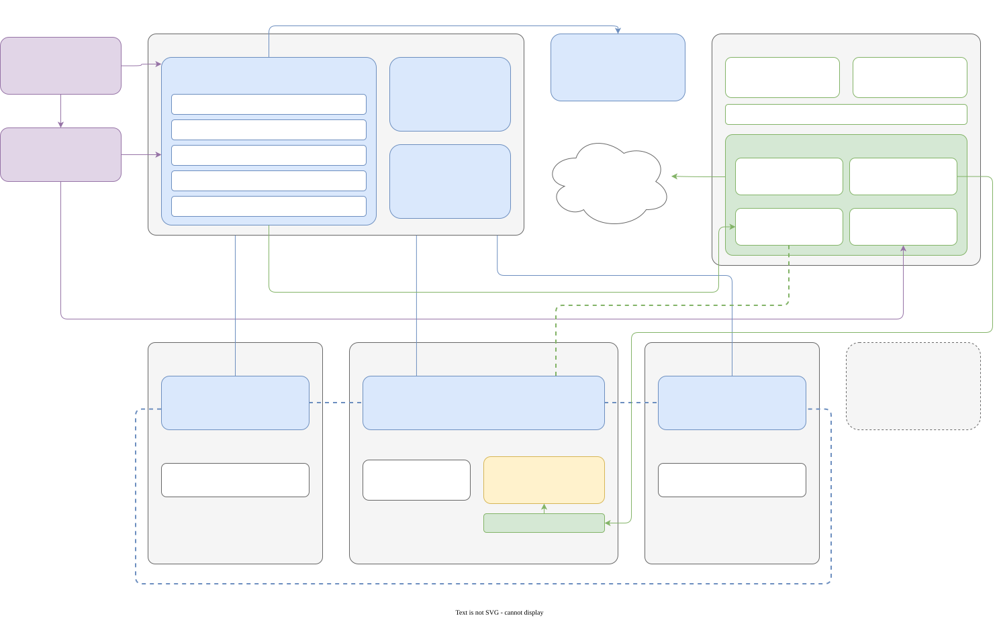
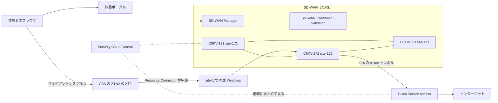

# 構成

ツアーの手順の挿絵は、この図のうちその手順で見るところだけを橙で囲んだものです。

## 全体のつながり

## 拠点とルータ

拠点は AWS 上に 3 つあり、それぞれ C8000v のルータが 1 台です。WAN はインターネット 1 本です。

| 拠点 | 型 | ホスト名 | System IP | WAN の color | LAN（CORP、VPN 10） |
|---|---|---|---|---|---|
| site-171 | データセンター | C8KV-171 | 17.1.1.1 | biz-internet | 10.171.10.0/24 |
| site-172 | 大規模拠点 | C8KV-172 | 17.1.1.2 | biz-internet | 10.172.10.0/24 |
| site-173 | 中規模拠点 | C8KV-173 | 17.1.1.3 | biz-internet | 10.173.10.0/24 |

- 3 拠点のどの 2 つの間にも SD-WAN のトンネルがある、フルメッシュの形です
- 各拠点の LAN に端末 VM（10.<site-id>.10.100）があります。体験者は使いません
- 物理のルータの拠点（site-71、73、74）もありますが、いまは保留中です。BASE-01 は site-74 の Configuration Group `SHOW-LARGE` を見ます

## サービス側の VPN

| VPN | 番号 | 用途 |
|---|---|---|
| INFRA | 1 | 基盤（管理） |
| CORP | 10 | 社員。AWS の拠点で LAN に出しているのはこれだけ |
| IOT | 20 | IoT 機器 |
| GUEST | 30 | ゲスト |

LAN のアドレスは `10.<site-id>.<VPN 番号>.0/24` で決めています。

## 体験者の席

| 席 | アドレス | 置き場所 |
|---|---|---|
| seat-172-1 | 10.172.10.101 | site-172 の CORP |
| seat-172-2 | 10.172.10.102 | site-172 の CORP |
| seat-172-3 | 10.172.10.103 | site-172 の CORP |

- 席は Windows で、ポータルが体験者に 1 人 1 つ割り当てます
- 体験者は CSA のクライアントレス ZTNA を使い、手元のブラウザから RDP で席に入ります。ログインは Duo（席ごとの共有の利用者）と、席の Windows の利用者 `visitor` の 2 回です
- 席のインターネット向けの通信は、C8KV-172 から CSA への IPsec のトンネル（SIA）を通り、CSA の Web のルールで検査されます

## 通信の 2 つの道

| 通信 | 道 | 見るツアー |
|---|---|---|
| 拠点どうし（例: site-171 の端末から site-172 の席） | SD-WAN のトンネル（BFD で品質を測る） | BASE-02、BASE-04 |
| site-172 の CORP からインターネット | C8KV-172 から CSA への SIA のトンネル。トンネルが使えないときは拠点から直接（NAT） | SSE-01、SSE-02、BASE-04 |
| 手元のブラウザから席の RDP | CSA の ZTNA。Resource Connector が中継し、SD-WAN のルータは通らない | SSE-03 |
